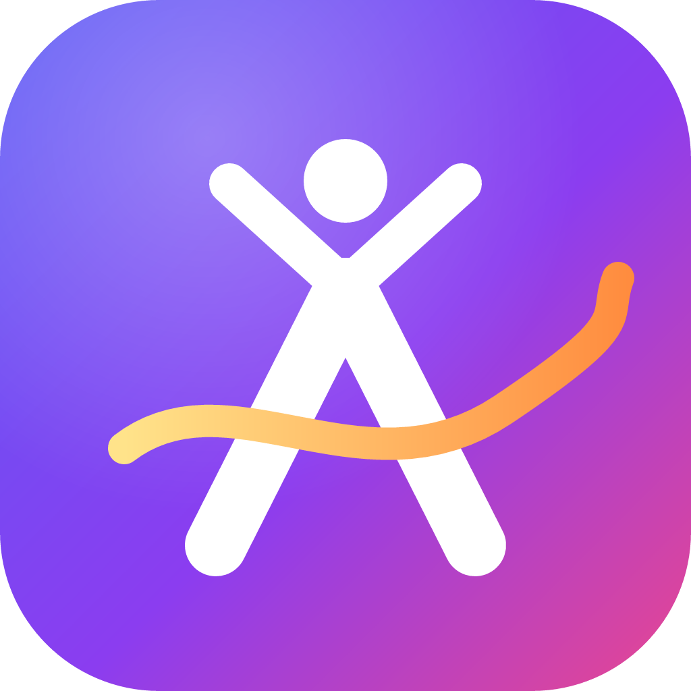

<p align="center"></p>

<h1 align="center">Athlos Suite</h1>
<p align="center"><b>Il gestionale desktop per società sportive</b><br>
Anagrafiche · Ricevute · Scadenzario certificati · Stampa · Salto Studio (video e grafica) · Comunica (social) · Squadra (chat dello staff)</p>

---

Athlos è un **programma Windows vero e proprio** (installer `.exe` e versione portatile): si apre nella sua finestra, funziona **senza internet** e salva i dati **sul computer della società**. Non apre il browser e non dipende da server esterni.

È configurato per **Athletic Club** con le cinque discipline: ginnastica artistica, ginnastica ritmica, judo, acrobatica aerea, salute e fitness. Ogni società può cambiare nome, dati, logo e discipline.

## Scaricare l'EXE

1. Apri la scheda **Actions** del repository, scegli l'ultima esecuzione di **“Crea EXE Windows”** e scarica l'artefatto **Athlos-Suite-Windows**.
2. Dentro trovi:
   - `Athlos-Suite-Setup-1.0.0.exe`: installer con collegamento sul desktop e nel menu Start;
   - `Athlos-Suite-Portable-1.0.0.exe`: si avvia senza installazione, anche da chiavetta USB.
3. Quando pubblichi un tag `v1.0.0`, gli stessi file vengono allegati automaticamente a una **Release**.

> L'EXE non è firmato digitalmente: al primo avvio Windows SmartScreen può mostrare “PC protetto”. Scegli **Ulteriori informazioni → Esegui comunque**. Per eliminare l'avviso serve un certificato di firma del codice.

## Cosa fa

### 1. Dati della società
- Società/associazione (**denominazione sociale** e forma giuridica) oppure **persona fisica** (nome e cognome).
- **Partita IVA** e **codice fiscale** con verifica automatica, indirizzo di **fatturazione**, codice SDI, PEC, IBAN.
- **Più sedi** (palestre), con sede principale.
- Logo, contatti e profili social, con anteprima di come appaiono sulle ricevute.

### 2. Discipline
Già pronte: ginnastica artistica, ritmica, judo, acrobatica aerea, salute e fitness. Ognuna ha colore, icona, foto di copertina, federazione, **quota mensile** e quota di iscrizione, che vengono proposte nelle ricevute.

### 3. Anagrafica clienti e atleti
- Nome, cognome, sesso, data e **luogo di nascita**, **residenza completa**, telefono, email.
- **Codice fiscale calcolato in automatico** (algoritmo ufficiale, 7.904 comuni ISTAT e stati esteri), verificato e **decodificabile** (dal codice ricava data, sesso e comune).
- Suggerimento dei comuni con **provincia e CAP compilati da soli**.
- **Genitore o tutore** (intestatario delle ricevute dei minorenni).
- **Data di scadenza del certificato medico** (agonistico, non agonistico, ludico-motorio).
- **Ricerca** per nome, cognome, codice fiscale, telefono e **disciplina** (es. “tutte le atlete di ritmica”, “Di Mauro”); ricerca globale con **Ctrl+K**.
- Filtri per stato del certificato, età e stato; importazione ed esportazione **Excel (CSV)**; stampa dell'elenco.
- Scheda atleta con **situazione dei pagamenti mese per mese**, storico, **tessera con QR** stampabile.

### 4. Ricevute
- **Ricevute generali** e **ricevute commerciali** con **numerazioni separate** che **ripartono da 1 ogni 1° gennaio** (Generale n. 1/2027, Commerciale n. 1/2027…).
- Denominazione della società su ogni ricevuta, dati del **genitore** (chi paga) e dell'**atleta**.
- Causali rapide, quota calcolata in base alla disciplina e ai **mesi** scelti, metodo di pagamento.
- **Importo in lettere** automatico, **marca da bollo** proposta sopra 77,47 €, dicitura per la **detrazione del 19%** per i ragazzi dai 5 ai 18 anni.
- **Anteprima dal vivo**, stampa su **A4, A5 o stampante termica 80/58 mm**, originale + copia sullo stesso foglio, **PDF**, conferma di pagamento su WhatsApp.
- Le ricevute annullate conservano il numero; si può eliminare solo l'ultima della serie. Registro esportabile per il commercialista.
- Numero iniziale configurabile per continuare la numerazione di un altro programma.

> I modelli delle ricevute della palestra potranno essere riprodotti fedelmente non appena disponibili.

### 5. Scadenzario dei certificati
- Certificati **scaduti**, **in scadenza nei prossimi 30 giorni** (preavviso modificabile), entro 90 giorni e mancanti; calendario dei prossimi 12 mesi.
- **Promemoria su WhatsApp** già scritto, inviabile con un clic o in **sequenza guidata** a tutte le famiglie; anche via email.
- Notifica di Windows all'avvio, rinnovo del certificato in due clic, registro dei promemoria inviati.

### 6. Stampa reale
Usa le **stampanti installate in Windows** (USB, rete, Wi-Fi, termiche, PDF): elenco delle stampanti, stampante predefinita, formato, copie, **stampa diretta** senza finestra, pagina di prova.

### 7. Salto Studio: editor video e grafica
Un mix tra CapCut e Canva in una finestra dedicata:
- **timeline multitraccia** con taglia, dividi, sposta tra tracce, aggancio magnetico, velocità, miniature e forme d'onda;
- **modifica diretta** sull'anteprima: sposta, ridimensiona, ruota, guide magnetiche, testo modificabile sul video;
- **40 filtri colore**, **20 effetti dinamici** (glitch, VHS, coriandoli, stelline, neve, bokeh, riflettore…), **chroma key** per il green screen, regolazioni (esposizione, contrasto, temperatura, vignettatura, grana…);
- **32 transizioni** (dissolvenze, tendine, cerchio, cuore, vortice, porte, pixel, glitch, cubo…);
- **22 animazioni** di entrata e uscita (anche macchina da scrivere e parole pop) e **11 movimenti continui**;
- **36 stili di testo**, 28 caratteri, forme, oltre 100 adesivi e icone;
- **voce fuori campo** registrata dal microfono mentre il video scorre, con **12 effetti voce** (robot, eco, radio, cattedrale, scoiattolo…);
- **6 basi musicali** e **18 effetti sonori** generati dall'app, senza diritti d'autore;
- **14 modelli pronti** (iscrizioni aperte, risultati di gara, saggio, compleanno, open day, Reel, locandina A4…) già compilati con nome, logo e contatti della società;
- esportazione in **MP4 (H.264)** fotogramma per fotogramma, compatibile con Instagram, TikTok, Facebook, WhatsApp e YouTube, oppure **PNG, JPG e PDF**.

Le combinazioni creative superano le 10.000 (ad esempio 40 filtri × 20 effetti × 22 animazioni × 32 transizioni).

### 8. Comunica: messaggi per i social
**37 modelli** (certificati, pagamenti, iscrizioni, gare, eventi, auguri, avvisi, promozioni, staff) adattati a **WhatsApp, Messenger, Facebook, Instagram e X**: anteprima realistica su telefono, conteggio caratteri (con regole di X), hashtag per disciplina, grassetto che funziona anche su Instagram, variabili automatiche, invio guidato a più famiglie e creazione della grafica in Salto Studio.

### 9. Squadra: la chat di lavoro
Chat tra i PC della palestra **sulla rete locale**, senza account e senza internet: canali (Generale, Segreteria, Istruttori, Gare), messaggi diretti, **conferme di consegna e lettura**, reazioni, risposte, messaggi fissati, **compiti da spuntare**, foto, risposte rapide e notifiche. I PC spenti recuperano i messaggi alla riaccensione.

> Al primo avvio Windows può chiedere il permesso del firewall: scegli “Consenti” per le reti private.

### E inoltre
Anteprima animata di benvenuto con configurazione guidata, panoramica con grafici e compleanni, tema chiaro/scuro, **PIN di accesso**, **backup automatico giornaliero** con ripristino ed esportazione su file, dati di esempio per fare pratica.

## Dove sono i dati
`%APPDATA%\Athlos Suite\` contiene l'archivio (`athlos-db.json`), le foto (`media`), la chat (`chat.json`) e i backup giornalieri (`backup`). I progetti di Salto Studio sono in `Documenti\Salto Studio`.

## Sviluppo

Requisiti: Node.js 22.

```bash
npm install          # dipendenze ed Electron
npm start            # avvia l'app
npm test             # test (codice fiscale, partita IVA, importi in lettere, CSV)
npm run dist:win     # crea installer e versione portatile in dist/
```

Struttura:

```
src/main/        processo principale: finestre, archivio, stampa, chat in rete locale
src/renderer/    interfaccia: schermate in js/views, Salto Studio in js/studio, stili in styles
scripts/         rigenerazione di font, icone ed elenco comuni
tests/           test automatici
```

## Prossimi passi
- Modelli di ricevuta identici a quelli già in uso in palestra.
- Invio **automatico** dei promemoria 30 giorni prima, tramite WhatsApp Business Platform (serve un account Meta con modelli di messaggio approvati).
- Pagamenti e ricevute collegati in modo ancora più stretto alle quote di ciascun atleta.

## Crediti
Comuni e codici catastali: ISTAT tramite [comuni-json](https://github.com/matteocontrini/comuni-json). Icone: [Lucide](https://lucide.dev) (ISC). Caratteri: Fontsource, SIL Open Font License. Creazione MP4: [mp4-muxer](https://github.com/Vanilagy/mp4-muxer) (MIT). QR code: [qrcode](https://github.com/soldair/node-qrcode) (MIT). Immagini delle discipline generate con intelligenza artificiale.
