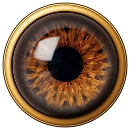

<p align="center"></p>

<h1 align="center">Breye Studio</h1>
<p align="center"><b>Br</b>(own) + <b>eye</b>: lo studio creativo con intelligenza artificiale.<br>
Chat · Immagini AI · Video AI · Design · Foto · Video Editor · Codice · Documenti & PDF · Strumenti</p>

---

Breye è un'app web che riunisce in un unico posto quello che di solito richiede ChatGPT, Canva, Photoshop, CapCut e gli strumenti Adobe. Gira interamente nel browser: niente installazione, niente chiavi API, i progetti restano sul dispositivo.

## Aprire l'app

- **Online**: apri `breye/index.html` da un hosting statico. Dal repository pubblico funziona subito con raw.githack, ad esempio
  `https://raw.githack.com/baccarossa2-ai/Claude/<branch>/breye/index.html`.
- **In locale**: `python3 -m http.server` dentro la cartella `breye/` e apri l'indirizzo che stampa. Il gateway AI aperto rifiuta l'origine `localhost`: usa l'indirizzo IP della rete locale o un nome host.
- **Dentro Claude**: la versione pubblicata come Artifact usa Claude come motore (testo, codice, visione) e il connettore Hugging Face per foto e video realistici.

## Il motore Iris

| Funzione | Online (web pubblico) | Dentro Claude |
| --- | --- | --- |
| Chat, scrittura, codice | gateway aperto Pollinations, senza chiave | Claude, senza chiave |
| Analisi di immagini, OCR | gateway aperto | Claude (visione) |
| Foto realistiche | Flux via Pollinations | Z-Image / FLUX via Hugging Face |
| Illustrazioni vettoriali | SVG scritti dal modello linguistico | idem |
| Scene 3D procedurali | shader GLSL scritti dal modello, resi sulla GPU | idem |
| Video realistici | foto realistiche animate in locale | Wan 2.2 via Hugging Face |
| Ritocco, montaggio, musica, PDF | nel browser | nel browser |

I limiti dipendono dai servizi gratuiti: il gateway anonimo ha un limite di frequenza e una piccola filigrana sulle foto; la quota GPU gratuita di Hugging Face è giornaliera. Vettoriale, procedurale, musica e tutti gli editor non hanno limiti.

## Sezioni

- **Iris Chat**: conversazioni salvate, streaming, Markdown e codice evidenziato, allegati (immagini, testi, PDF), personalità (scrittrice, sviluppatrice, traduttrice…), immagini in chat con `/immagine`.
- **Immagini AI**: tre motori, 13 stili, 7 formati, varianti, prompt negativo, miglioramento del prompt, galleria locale, scene GPU dal vivo.
- **Video AI**: dall'idea allo storyboard (scene, testi, camera, particelle, transizioni “iride” e “battito di ciglia”), musica generata, foto animate, export MP4.
- **Design Studio**: Fabric.js, 12 modelli adattivi, 15 formati, forme, 330 icone, adesivi, 47 font, abbinamenti tipografici, sfondi e gradienti, palette di brand, livelli, pagine multiple, Magic Resize, Magic Design, Magic Write, assistente che modifica il design a parole, export PNG/JPG/SVG/PDF/ZIP.
- **Foto Studio**: livelli con fusioni e opacità, 20 strumenti (pennello, gomma, selezioni, lazo, bacchetta magica, ritaglio, secchiello, sfumatura, testo, forme, contagocce, timbro clone, rimozione oggetti, sfoca, schiarisci/brucia), 18 regolazioni, 13 filtri, auto-miglioramento, color grading da testo, rimozione sfondo, riempimento generativo, espansione, ingrandimento 2×.
- **Video Editor**: timeline a 5 tracce, trascinamento e rifilatura, divisione, velocità, volume e dissolvenze, 11 filtri, 10 transizioni, testi con 7 stili e animazioni, taglio automatico dei silenzi, sottotitoli parola per parola da script, script AI, musica AI, export MP4 con WebCodecs.
- **Code Studio**: CodeMirror, più file, anteprima dal vivo su desktop/tablet/telefono, console, modelli, programmatrice AI che crea e corregge interi progetti, export ZIP o file unico.
- **Documenti & PDF**: editor con scrittura AI e trasformazioni del testo, modelli, import DOCX/MD/HTML, export PDF/Word/Markdown/HTML; unisci, estrai, ruota, riordina, duplica pagine, immagini in PDF, PDF in immagini, filigrana, numeri di pagina, chat con il PDF.
- **Strumenti**: rimozione sfondo, conversione e compressione, palette da foto e da testo, QR, gradienti, musica, OCR, collage, icone app, lettura vocale, nomi e slogan.

## Struttura

```
breye/
  index.html          pagina dell'app
  css/breye.css       sistema di design (palette dell'iride, componenti, shell)
  css/studios.css     stili delle sezioni
  js/core.js          utilità, archivio IndexedDB, router, finestre, comandi
  js/ai.js            motore Iris e runner degli shader
  js/*.js             una sezione per file
  assets/             logo e iride (sfondo trasparente, anello dorato)
```

Librerie open source caricate da cdnjs/jsDelivr: Fabric.js, CodeMirror, marked, DOMPurify, highlight.js, pdf.js, pdf-lib, jsPDF, html2canvas, JSZip, QRious, mammoth, turndown, mp4-muxer. Icone: sottoinsieme di Lucide (ISC).
